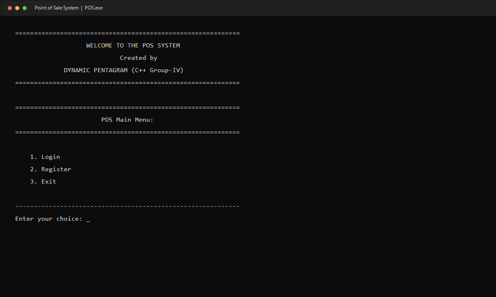
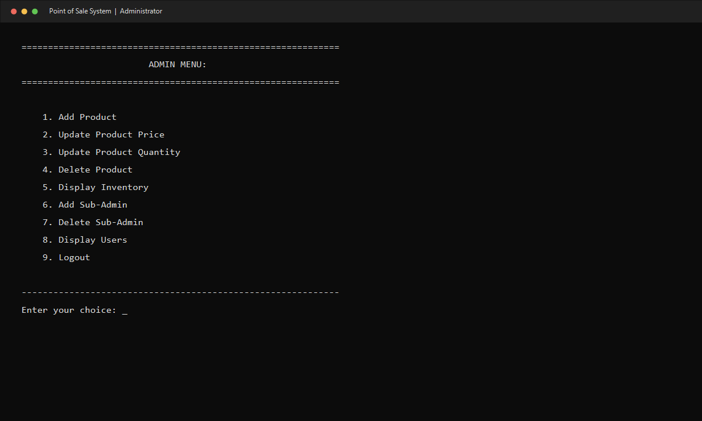
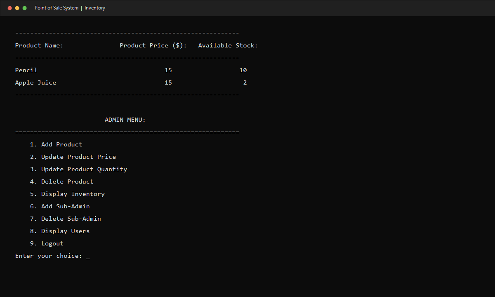

# Point-of-Sale and Inventory System — C++

A **Semester II console application** built with C++ for learning object-oriented programming, inventory management, and menu-driven transaction workflows. The project was developed as a group exercise at the University of Information Technology.

**Project type:** Group project (solo developed)

**Project leader:** Aung Myo Pyae

**Development:** This C++ POS application was assigned as group coursework. Aung Myo Pyae implemented the project individually.

## Screenshots

## Features

- Product records with a name, price, and available quantity.
- Inventory listing, searching, adding, deleting, and price/quantity updates.
- Customer registration and login, an administrator workflow, and sub-administrator management.
- Cart additions with stock checks, cart display, and item removal.
- Checkout with cash calculation and simulated card/digital-payment options.
- Receipt generation and local text-file persistence for inventory and sub-administrators.

## How it works

1. main() creates the POS application, which loads local inventory and sub-administrator data where available.
2. The startup menu offers login, customer registration, and exit.
3. After login, the user's role selects either an administrative menu or customer shopping menu.
4. Administrators maintain the stock records. Customers select a product and quantity to put in the cart.
5. Adding an item reduces its stored inventory quantity immediately. Removing cart items restores that quantity.
6. Checkout totals the cart. Cash payments calculate change; card and digital-payment choices print demonstration messages.
7. A successful sale writes receipt.txt and clears the cart.

## Code organization

The implementation is kept in POS.cpp:

| Class | Responsibility |
| --- | --- |
| Product | Product name, price, quantity, and accessors |
| Inventory | Product collection, stock changes, and inventory file I/O |
| User | Account fields and credential comparison |
| UserManager | Registration, authentication, and sub-administrator management |
| Transaction | Cart operations, checkout, and receipt output |
| POS | Main application menus and user interaction |

Product name comparisons normalize case. Registration includes password checks. These checks demonstrate input validation; they do not provide production account security.

## Build and run

Install a C++17-capable compiler such as GCC/g++.

~~~sh
g++ -std=c++17 -Wall -Wextra POS.cpp -o pos-system
./pos-system
~~~

On Windows, build with an available C++ compiler and run pos-system.exe from the repository directory. No external C++ packages or database server are required.

## Demo walkthrough

The source includes a local demonstration administrator: username **admin**, password **Admin@123**. Use it only with this offline prototype.

1. Log in as the demo administrator and add sample products with prices and stock.
2. Log out, register a disposable customer account, and sign in.
3. Add a product to the cart and inspect the total.
4. Remove a quantity to see it returned to inventory.
5. Choose cash checkout and supply an amount at least equal to the total.
6. Open receipt.txt to inspect the generated receipt.

## Local files

| File | Purpose |
| --- | --- |
| inventory.txt | Saved product inventory |
| sub_admins.txt | Local sub-administrator credentials |
| receipt.txt | Most recently generated sale receipt |
| temp.txt | Temporary file used during account-file updates |

Generated files are excluded from version control. Run the application from a writable directory.

## Limitations and learning outcomes

This project demonstrates classes, vectors, control flow, streams, file I/O, and state changes across menus. Credentials are compared/stored as plaintext and a demo administrator is hardcoded. Payment choices are simulations. Stock is reduced when items enter the cart, so interrupted sessions need careful handling. The application is a learning prototype rather than a production retail service.

## Credits

Semester II C++ group project, presented in the program as Dynamic Pentagram / Group IV. The C++ implementation was written individually by Aung Myo Pyae. Duplicate identical copies of POS.cpp have been consolidated into one source file.
